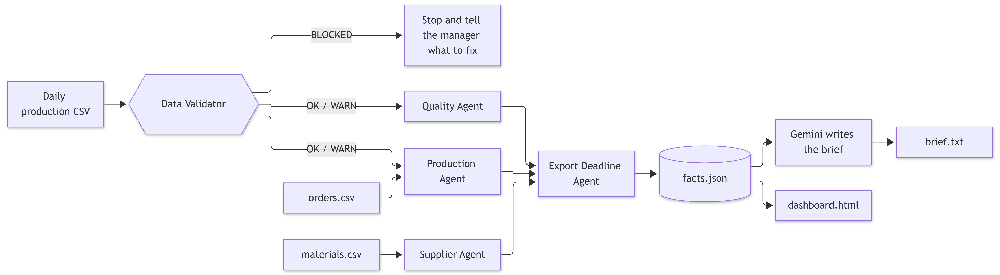

# BunonAI

**A virtual operations manager for small garment factories.**

Every evening, BunonAI reads the factory's daily production sheet, looks for delays, late materials and quality problems, and forecasts whether each export order will ship on time. It then sends the manager a short brief in Bangla and English, with recovery options and the numbers behind them.

## The problem

Small garment manufacturers lose money in four familiar ways:

- Raw materials and trims arrive late
- Production falls behind plan
- Quality defects lead to rework
- Shipment deadlines are missed

In most cases the manager finds out too late, not because the signs were hidden, but because nobody has the time to do the calculations at the end of a long day.

## What BunonAI does

BunonAI is a small team of agents, each responsible for one job.

| Agent | Responsibility |
|---|---|
| **Data Validator** | Checks the daily CSV before anything else runs. Catches typos, missing days and impossible numbers. |
| **Production Agent** | Measures actual speed against plan, forecasts the shortfall, and estimates where pieces are being lost. |
| **Quality Agent** | Tracks DHU (defects per 100 pieces) by line, flags spike days, and forecasts the rework load. |
| **Supplier Agent** | Identifies late or at-risk materials and drafts a follow-up message to the supplier. |
| **Export Deadline Agent** | Combines the three agents above to answer one question: will this order ship on time? It also shows what each recovery option would achieve. |
| **Brief Writer (Gemini)** | Turns the finished numbers into a short, WhatsApp-style message in Bangla and English. |
| **Dashboard** | A single self-contained HTML page with charts, a "what to do today" list and the brief. |

**A worked example:** an order is due in four working days. The agents find that the factory is running at 74% of plan, that the buttons are late, and that quality is on target. They forecast a shortfall of about 1,287 pieces and show that working Friday plus three hours of overtime per day would close the gap. They also draft the message to the button supplier. The manager then decides what to do.

## Design principles

1. **Code does the maths; the LLM does the language.** Every number is produced by plain, deterministic Python. Gemini receives finished facts and is instructed not to invent or recalculate anything.
2. **Say "I don't know" rather than guess.** If the data is stale or broken, the agents do not run, and the manager is told exactly what to fix.
3. **Show assumptions and uncertainty.** Loss reasons are labelled as estimates, and weak signals are marked as small samples.
4. **The manager decides.** The agents offer options with numbers, never orders. They know nothing about labour cost, worker consent or buyer relationships.
5. **Works without AI.** If there is no API key, or the API call fails, a plain template brief is produced instead.
6. **Local-first.** It runs on an ordinary Windows, Mac or Linux computer using CSV files. No server is needed.

## How it works


### The forecast, in brief

- **Current speed** is the average output of the last three *complete* days, meaning days on which every line reported.
- **Working days left** is the number of calendar days to the deadline, excluding the weekly day off (Friday by default).
- **Projected total** is the quantity produced so far plus current speed multiplied by the working days left. **Shortfall** is the ordered quantity minus the projected total.
- The Export agent also deducts a packing and inspection buffer and the pieces lost while sewing waits for missing material, and it adds the time needed for rework.
- **Risk levels:**
  - **LOW**: on track
  - **MEDIUM**: up to 5% short
  - **HIGH**: more than 5% short
  - **VERY HIGH**: cannot be met even at 100% of plan

## Project structure

```
BunonAI/
├── data_validator.py        # Gate: checks the CSV before anything runs
├── production_agent.py      # Speed, delay, shortfall, loss reasons
├── quality_agent.py         # DHU, spikes, rework forecast
├── supplier_agent.py        # Material status and supplier follow-up drafts
├── export_agent.py          # Combines everything: will it ship on time?
├── run_all.py               # Runs the full pipeline, saves reports, writes the brief
├── alert_writer.py          # Standalone Gemini alert test (also lists available models)
├── make_dashboard.py        # Builds dashboard.html from the latest report
├── run_daily.bat            # Windows Task Scheduler entry point
├── requirements.txt
├── .env.example             # Copy to .env and add your key
├── orders.csv               # Open orders: quantity and ship date (sample)
├── materials.csv            # Purchase orders and material status (sample)
├── BunonAI_daily_production_dataset.csv        # Daily production (sample)
├── BunonAI_daily_production_BAD_TEST.csv       # Same data with deliberate errors, for testing the validator
└── reports/                 # Generated: one folder per day
    └── 2026-11-10/
        ├── production.md  quality.md  supplier.md  export.md
        ├── data_check.md  facts.json  gemini_prompt.txt  brief.txt
```

## Quick start

BunonAI requires **Python 3.9 or later**. It was developed on a recent Python 3 release; older versions are untested.

```bash
# 1. Get the code
git clone https://github.com/<your-username>/BunonAI.git
cd BunonAI

# 2. Create a virtual environment
python -m venv .venv
.venv\Scripts\activate          # Windows
# source .venv/bin/activate     # macOS / Linux

# 3. Install dependencies
pip install -r requirements.txt

# 4. Add your Gemini key (optional: without it you get the plain brief)
copy .env.example .env          # Windows (use `cp` on macOS / Linux)
# then edit .env and paste your key

# 5. Run the pipeline
python run_all.py
python make_dashboard.py
start dashboard.html            # Windows (use `open` or `xdg-open` elsewhere)
```

You can get a Gemini API key from [Google AI Studio](https://aistudio.google.com/apikey).

## Keeping your API key secret

- Your key belongs **only** in `.env`. The included `.gitignore` keeps that file out of Git.
- Never paste the key into code, issues, screenshots or chats.
- If a key is ever exposed, delete it in AI Studio and create a new one straight away.

## Input files

### 1. Daily production CSV

One row per **date + line + order**.

| Column | Meaning |
|---|---|
| `date` | Date in `YYYY-MM-DD` format |
| `line` | Production line, e.g. `Line-1` |
| `order_id` | Order reference, e.g. `PO-2330` |
| `style` | Garment style |
| `operators_planned`, `operators_present`, `absent` | Staffing |
| `planned_output`, `actual_output` | Pieces |
| `downtime_min`, `downtime_reason` | Minutes lost and the reason |
| `defects_found` | Defects counted that day |

### 2. `orders.csv`

```csv
order_id,style,order_qty,due_date,status
PO-2330,Polo-Shirt-Black,6000,2026-11-15,open
```

Only rows with `status = open` are monitored.

### 3. `materials.csv`

```csv
order_id,item,stage,supplier,qty_ordered,qty_received,per_piece,unit,promised_date,latest_eta,needed_by
PO-2330,Buttons 4-hole black,sewing,Dhaka Trims,6200,3500,1,pcs,2026-11-08,2026-11-12,2026-11-11
```

`stage` is either `sewing` (a shortage can stop the lines) or `packing`. `per_piece` is the amount of the item that one garment uses.

## Usage

```bash
python run_all.py                        # Full pipeline, as of the latest date in the data
python run_all.py --dry-run              # Build everything and print the Gemini prompt, without calling Gemini
python run_all.py --as-of 2026-11-09     # Pretend it is that day (useful for testing day-to-day comparison)
python run_all.py --today 2026-11-14     # Pretend today is this date (tests the "no data" block)
python run_all.py --data other.csv       # Use a different production file

python data_validator.py                 # Check the data only
python data_validator.py BunonAI_daily_production_BAD_TEST.csv --today 2026-11-10

python production_agent.py               # Run a single agent
python quality_agent.py
python supplier_agent.py
python export_agent.py

python alert_writer.py --models          # List the Gemini models your key can use
python make_dashboard.py                 # Rebuild dashboard.html from the latest report
```

### Data validator results

| Status | Meaning | What happens |
|---|---|---|
| `OK` | No problems found | Agents run |
| `WARN` | Minor issues, or bad rows were removed | Agents run, and the brief opens with a data warning |
| `BLOCKED` | Unreadable file, missing columns, or no data for recent working days | Agents do **not** run; the exit code is `2` |

Row numbers in the report match Excel row numbers, with row 1 being the header.

### Running it every evening (Windows)

```powershell
schtasks /Create /TN "BunonAI Daily Brief" /TR "C:\path\to\BunonAI\run_daily.bat" /SC WEEKLY /D SAT,SUN,MON,TUE,WED,THU /ST 18:00
```

Friday is skipped because the factory is closed. Output is appended to `logs\run.log`.

## Configuration

All settings are plain constants at the top of each file. **Several of them are assumptions, so adjust them to match your factory.**

| Setting | File | Default | Meaning |
|---|---|---|---|
| `WEEKLY_OFF` | `production_agent.py` | `4` (Friday) | Weekly closed day (0 = Monday … 6 = Sunday) |
| `SHIFT_HOURS` | `production_agent.py` | `8` | Normal shift length in hours |
| `RATE_WINDOW` | `production_agent.py` | `3` | Number of days used to measure current speed |
| `AMBER_PCT` | `production_agent.py` | `5` | Shortfall percentage still counted as amber |
| `TARGET_DHU` | `quality_agent.py` | `3.0` | Your quality target (defects per 100 pieces) |
| `SPIKE_DHU` | `quality_agent.py` | `4.0` | A single line-day above this value counts as a spike |
| `BUFFER_DAYS` | `supplier_agent.py` | `1` | How many days early material should arrive |
| `FINISH_BUFFER_WD` | `export_agent.py` | `1` | Working days between the end of sewing and the ship date |
| `REWORK_MIN_PER_DEFECT` | `export_agent.py` | `6` | Minutes needed to repair one defect |
| `OT_REALISTIC_MAX` | `export_agent.py` | `3` | Overtime hours per day above which the plan is flagged as hard to sustain |
| Thresholds | `data_validator.py` | See file | Over-plan ratios, maximum DHU, gap look-back |
| `GEMINI_MODEL` | `.env` | `gemini-3.7-flash` | Model name (check with `alert_writer.py --models`) |

## Example output

This is the plain brief (no AI), generated from the sample data:

```
BunonAI daily brief - 2026-11-10

PO-2330 (Polo-Shirt-Black): ship risk 🚨 VERY HIGH
- Ready by sewing deadline (2026-11-14): ~4,713 of 6,000 -> shortfall ~1,287
- Need 730/day, running 606/day (74.4% of plan)
- Material: Buttons 4-hole black (Dhaka Trims) LATE - balance 2,700 pcs
- Quality: DHU 2.69 (target 3.0)
- Options (remaining shortfall): 2h OT 833 | Friday 681 | Friday+2h OT 75 | Friday+3h OT 0
```

The dashboard adds a welcome banner, a progress donut, plan-versus-actual and efficiency charts, a DHU trend, per-line efficiency, a loss breakdown, recovery options, a materials table and a "what to do today" list.

<!-- Add a screenshot:  -->

## Limitations

Please keep these in mind before drawing any conclusions from the output.

- **Sample data only.** The production CSV is sample data, and `orders.csv` and `materials.csv` contain assumed quantities, dates and suppliers. The headline figures (for example, 1,287 pieces short) do not come from a real factory.
- **Loss reasons are estimates.** Pieces lost to downtime and absenteeism are derived, and "slow speed / other" is simply whatever remains unexplained.
- **No defect types.** The data holds only a defect count, so the Quality Agent can show where and when quality drops, but not what the recurring problem is (open seam, skipped stitch and so on). Adding a `defect_type` column is the most valuable upgrade.
- **Plausible-looking errors slip through.** The validator cannot catch a wrong number that looks right, such as 402 typed instead of 420.
- **LLM output must be checked.** Gemini is told to use only the numbers it is given, but you should always compare the brief against `facts.json` and `gemini_prompt.txt`.
- **The dashboard is static.** It is a snapshot of the last run, not a live page.
- **Nothing is sent yet.** The brief is saved to a file; there is no WhatsApp or Telegram delivery.
- **The material model is simple.** It assumes material arrives at the start of the ETA day and that one unit is used per piece (controlled by `per_piece`).
- **Windows-first.** The scheduling instructions are for Windows. The core Python code should run elsewhere but has been tested less.

## সংক্ষেপে (বাংলায়)

BunonAI ছোট garment factory-র জন্য একটি "virtual operations manager"। প্রতিদিনের production CSV পড়ে এটি বলে দেয় কোন order পিছিয়ে আছে, কত piece কম পড়বে, কোন material দেরি করছে, quality কেমন, আর shipment-এর দিনে order তৈরি থাকবে কিনা। সংখ্যাগুলো সাধারণ Python code হিসাব করে, Gemini শুধু বাংলা-English বার্তা লেখে। ডেটা ভুল বা পুরনো হলে agent চুপচাপ ভুল উত্তর না দিয়ে থেমে যায় এবং কী ঠিক করতে হবে জানায়। সিদ্ধান্ত সবসময় manager-এর।

## Contributing

Issues and pull requests are welcome. The most useful contribution right now is **real, anonymised factory data**, along with feedback from people who run garment production.
<br/><br/>

<div align="center">
  <!-- Owner Name -->
  <h2>
    Crafted with passion by
  </h2>

  <a href="https://github.com/bokhtearmdabid">
    
  </a>

  <br/>

  <!-- Contact Information -->
  <h3>🤝 Let's Connect</h3>

  <a href="https://github.com/bokhtearmdabid">
    
  </a>
  <a href="mailto:bokhtearmdabid@gmail.com">
    
  </a>
  <a href="https://www.linkedin.com/in/bokhtear-md-abid">
    
  </a>

  <br/>

  

   
</div>

